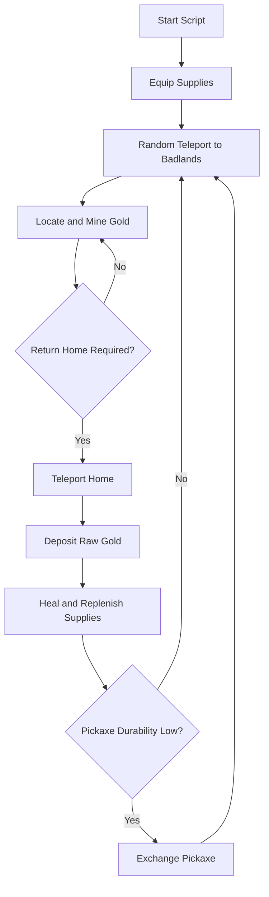
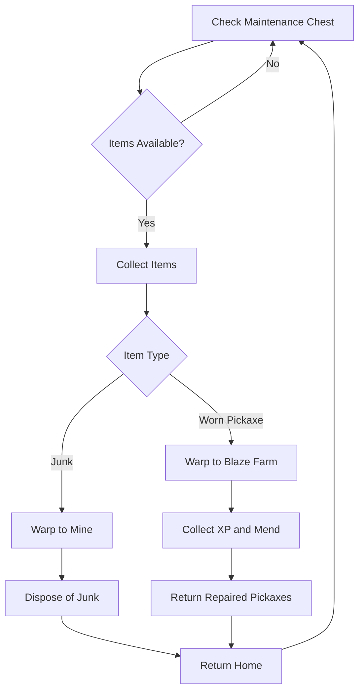

# DIH Client — Automated Gold Mining System

An automated Minecraft gold-mining and pickaxe-maintenance system powered by the DIH Client.

The system consists of two specialised scripts:

- `gold_dropper.dscript` — Automated gold mining, resource collection and delivery.
- `pickaxe_mender.dscript` — Automated pickaxe repair, redistribution and junk disposal.

Multiple gold miners can operate alongside a dedicated pickaxe mender to create a continuous mining operation.

---

## 1. Installation

1. Download the [DIH Client](https://dih.lxysg.com).
2. Launch Minecraft using the client.
3. Join the server.
4. Run the following command:

   ```text
   .scripts add gold_dropper
   ```

5. Copy and paste the contents of `gold_dropper.dscript` into the newly created script.
6. Prepare your mining headquarters using the instructions below.
7. Set your `/home` at the designated gold collection point.
8. Run the script.

### Source Code & Documentation

The DIH Client is open source and available for inspection.

- [Official Website](https://dih.lxysg.com)
- [GitHub Repository](https://github.com/ahigherdesire/dih-client)
- [Scripting and AI Agent Documentation](https://dih.lxysg.com/agents.md)

---

## 2. Mining Headquarters Setup

Before starting the scripts, construct a centralised headquarters where the bots can replenish supplies, deposit resources and exchange equipment.

### Collection System

You will need:

- A water stream connected to your storage system.
- Alternatively, a hopper-based collection system.
- A designated `/home` location for the mining bots.
- Storage chests accessible from the bots' `/home` location.

The water stream or hoppers must be directly in front of the bots when they teleport home.

Ensure that all supply chests are within interaction range without requiring the mining bots to move.

### Required Chests

| Chest | Contents | Identification |
|---|---|---|
| Pickaxe Supply | Fresh or repaired pickaxes | Glass pane in the first slot |
| Maintenance & Junk | Worn pickaxes and unwanted items | Emerald in the first slot |
| Food Supply | Cooked beef or golden carrots | As configured in the script |
| Water Bucket Supply | Water buckets | As configured in the script |
| Raw Gold Supply | Approximately 128 raw gold | As configured in the script |

> [!IMPORTANT]
> The emerald used to identify the maintenance chest must be a regular emerald, NOT a shop advertisement gem.

Do not remove or replace the identification items while the scripts are running.

### Water Bucket Supply

Water buckets are used for emergency MLG water-bucket landings.

The water bucket chest may require frequent replenishment.

For a more sustainable system, construct a 2×2 infinite water source and modify the script to refill empty buckets automatically.

Refer to the DIH scripting documentation when implementing this modification.

---

## 3. Gold Miner — `gold_dropper.dscript`

The gold miner is responsible for locating, mining and delivering raw gold to your centralised storage system.

### Initial Equipment

When the script starts, the bot collects:

- A water bucket for emergency landings.
- A pickaxe.
- Food for healing and hunger management.
- Raw gold to fill the required inventory slots.

Ensure that all necessary supplies are available before starting the bot.

### Automated Mining Cycle

The bot performs the following sequence:

1. Teleports home and equips itself.
2. Executes `/rtpmenu`.
3. Selects the Overworld.
4. Selects the Badlands biome.
5. Searches for gold ore.
6. Mines and collects raw gold.
7. Returns home when necessary.
8. Deposits raw gold into the collection system.
9. Replenishes supplies and resumes mining.

### Automatic Event Handling

| Event | Automated Response |
|---|---|
| Low health | Returns home, deposits gold, heals and resumes mining. |
| Nearby player detected | Returns home, deposits gold, heals if necessary and resumes mining. |
| Death | Returns to the headquarters and automatically re-equips. |
| Low pickaxe durability | Deposits the worn pickaxe into the emerald-marked chest and collects a replacement. |
| Server restart | Attempts to reconnect automatically. |

### Mining Workflow



---

## 4. Pickaxe Mender — `pickaxe_mender.dscript`

The pickaxe mender is a dedicated maintenance bot that keeps the mining operation supplied with usable pickaxes.

### Requirements

- A sword, preferably a fully enchanted netherite sword.
- Pickaxes enchanted with Mending.
- Access to the emerald-marked maintenance chest.
- Access to the glass-pane-marked pickaxe supply chest.
- Access to `/warp mine`.
- Access to `/warp blaze67`.
- A correctly configured home location.

### Automated Maintenance Cycle

The mender continuously checks the maintenance chest for worn pickaxes and unwanted items.

#### Junk Disposal

When unwanted items are detected, the bot:

1. Collects the unwanted items.
2. Executes `/warp mine`.
3. Deposits the unwanted items at the designated location.
4. Returns to the headquarters.

#### Pickaxe Repair

When worn pickaxes are detected, the bot:

1. Collects the worn pickaxes.
2. Executes `/warp blaze67`.
3. Kills blazes to collect experience.
4. Uses the collected experience to repair pickaxes through Mending.
5. Returns to the headquarters.
6. Deposits the repaired pickaxes into the glass-pane-marked chest.
7. Repeats the maintenance cycle.

### Maintenance Workflow



---

## 5. Pre-Launch Checklist

Before leaving the operation unattended, verify the following:

- [ ] All bots have correctly configured home locations.
- [ ] Water streams and hoppers are functioning.
- [ ] The storage system has sufficient capacity.
- [ ] All required chests are within interaction range.
- [ ] The pickaxe supply chest contains a glass pane in its first slot.
- [ ] The maintenance chest contains a regular emerald in its first slot.
- [ ] Sufficient pickaxes are available.
- [ ] Pickaxes have the Mending enchantment.
- [ ] Food supplies are stocked.
- [ ] Water buckets are stocked.
- [ ] Approximately 128 raw gold is available in the raw gold supply chest.
- [ ] The maintenance bot has a suitable sword.
- [ ] All required teleportation commands work.
- [ ] Both scripts have been tested individually.
- [ ] The server permits the intended automation.

---

## 6. Troubleshooting

### The Script Does Not Work!

Do not immediately assume the entire script is broken.

First, check the following:

| Problem | Possible Cause |
|---|---|
| Bot cannot access chests | Incorrect home position or chest placement |
| Bot cannot identify a chest | Missing or incorrect identification item |
| Bot does not collect equipment | Empty chest or incorrect item configuration |
| Bot repeatedly dies | Insufficient food, equipment or failed emergency landings |
| Bot does not return home | Incorrect home configuration or teleportation failure |
| Bot does not deposit gold | Incorrect positioning or blocked collection system |
| Pickaxes are not repaired | Missing Mending enchantment or insufficient XP |
| Bot cannot teleport | Changed server menus, cooldowns or unavailable warps |
| Bot stops after restart | Reconnection or script state issue |

### Debugging with Claude or ChatGPT

If the issue persists, provide the relevant script and the official scripting documentation to Claude or ChatGPT.

Documentation:

https://dih.lxysg.com/agents.md

Include the following information:

- The complete script.
- The intended behaviour.
- The actual behaviour.
- Error messages and console logs.
- The circumstances under which the problem occurs.
- Whether the problem is consistent or intermittent.
- Your DIH Client version.
- Any recent server or script changes.

### Recommended AI Debugging Prompt

```text
You are an experienced DIH Client scripting developer.

Read the official scripting documentation:
https://dih.lxysg.com/agents.md

Analyse the attached script and identify the root cause
of the following issue.

Expected behaviour:
[Describe what should happen]

Actual behaviour:
[Describe what actually happens]

Error messages or logs:
[Paste relevant logs]

Conditions required to reproduce:
[Describe the circumstances]

Requirements:
- Follow the official DIH scripting API.
- Do not invent unsupported functions or methods.
- Preserve existing working functionality.
- Identify the root cause before modifying the code.
- Improve error handling where appropriate.
- Prevent unnecessary infinite loops.
- Handle unexpected server responses gracefully.
- Provide the complete corrected script.
- Explain all significant modifications.
- Provide a testing procedure.
```

---

## 7. Routine Maintenance

Although the system is automated, it still requires occasional supervision.

### Regular Checks

- Replenish food and water buckets.
- Verify that pickaxes are being repaired and redistributed.
- Check for full chests or blocked hoppers.
- Ensure that all bots are still connected.
- Monitor unexpected deaths and script errors.
- Check whether server updates have changed menus or commands.
- Ensure that the gold storage system has sufficient capacity.

Test new script modifications using a single bot before deploying them across the entire mining operation.

---

## 8. Earnings & In-Game Asset Management

The mining operation has a reported earning potential of approximately:

**1,000,000,000 in-game currency per day.**

Actual earnings depend on:

- Number of active mining bots.
- Mining efficiency.
- Bot uptime.
- Server performance.
- Gold selling prices.
- Equipment availability.
- Server economy changes.

This figure is an estimate, not guaranteed revenue.

### Potential In-Game Assets

If you intend to diversify your in-game wealth, consider the following items:

| Item | Consideration |
|---|---|
| Elytras | High-value equipment |
| Maces | Potentially high demand |
| Golden apples | Consumable assets |
| Armour sets | Useful equipment with resale potential |
| Netherite ingots | Valuable crafting materials |
| Ancient debris | Raw material for netherite |
| Totems of Undying | Recurring survival demand |

Market prices can fluctuate considerably. No item is guaranteed to retain its value.

Gambling is not a reliable wealth-management strategy.

---

## 9. Important Warnings

> [!CAUTION]
> Automated mining may violate server rules and result in permanent account bans, inventory confiscation or currency removal.

- Read the server's rules before using these scripts.
- Only operate bots where automation is permitted.
- Do not assume that automated reconnection guarantees continuous operation.
- Do not assume that converting currency into items protects it from server enforcement.
- Inspect third-party source code before executing it.
- Never provide account credentials, session tokens or other sensitive information to untrusted scripts.
- Keep backups of working script versions.
- Use this software at your own risk.

---

## 10. Useful Links

| Resource | Link |
|---|---|
| DIH Client Download | [dih.lxysg.com](https://dih.lxysg.com) |
| Open-Source Repository | [GitHub](https://github.com/ahigherdesire/dih-client) |
| Scripting Documentation | [agents.md](https://dih.lxysg.com/agents.md) |

---

**Happy mining. May your pickaxes never break and your hoppers never clog.**
